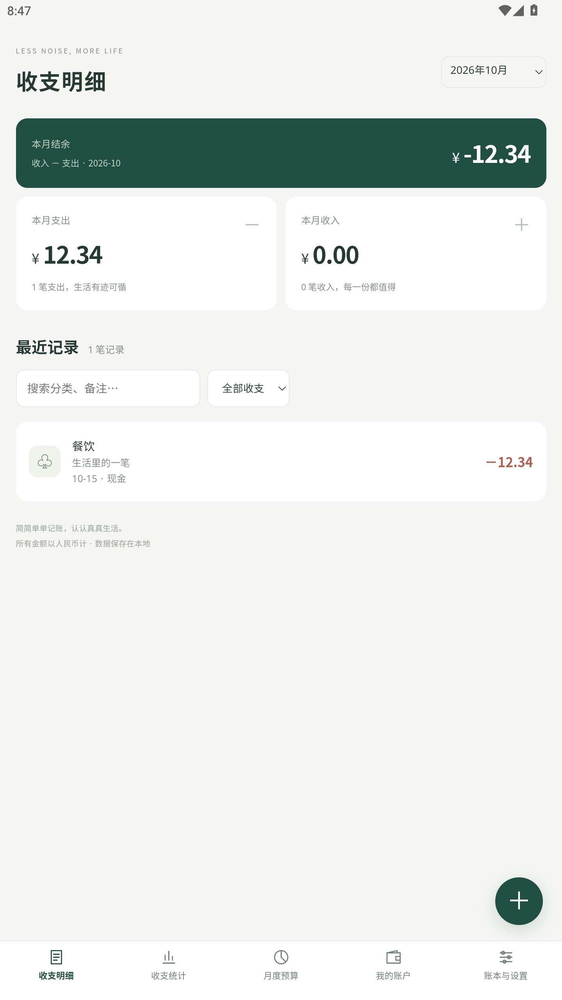

# 晴空 · 清透蓝色

仅改变视觉与导航布局，功能及数据格式与 main 一致。

# 简账 · Plain Ledger

**把生活记清楚。** 一个界面简洁、数据留在本地的 Android 记账应用，同时提供电脑实时预览。

无需账号，无广告，无会员付费。Android 应用不申请联网权限，所有记账数据保存在本地 SQLite 中。

<p align="center">
  
</p>

> 截图中的 12.34 元是开发测试记录，不是真实个人账单。此仓库不包含任何用户数据库、备份文件或签名密钥。

## 分支预览

[版本与分支说明](docs/BRANCHES.md)：`ui/paper` 纸感、`ui/sky` 蓝色；`feature/shared-ledger` 基于当前 UI 增加账号和共享服务器。离线 main 保持本地存储。

## 功能

| 模块 | 支持内容 |
|---|---|
| 日历首页 | 每日净收支、点击日期查看明细、月份切换与回到今天 |
| 收支记录 | 新增、编辑、删除；金额、分类、账户、日期和备注 |
| 分类 | 默认展示 16 个常用支出、6 个常用收入分类；“更多分类”可展开完整分类，自定义分类始终可见 |
| 多账本 | 独立账本入口与卡片，展示结余、笔数和当前账本；支持新建、切换、改名 |
| 界面设置 | 自选底部导航入口，偏好保存在当前设备；统一圆角下拉菜单 |
| 账户 | 初始余额、当前余额、账户间转账；转账不计入收入或支出 |
| 检索 | 按月查看、收支类型筛选、分类与备注关键词搜索 |
| 统计 | 网页支持自选日期范围、等长上期对比、折线、环图、支出热力、账户汇总及大额排行；App 保留月度简洁统计 |
| 预算 | 按账本和月份设置预算，查看剩余额度与超支 |
| 数据迁移 | JSON 全量备份与恢复、CSV 流水导出 |

金额以整数“分”存储与计算，避免使用浮点数累计金额。SQLite 事务同时保存应用状态与账单表。

## 快速体验电脑版

需要 Python 3.9 或以上版本，仅使用标准库，无需安装额外依赖。

```bash
git clone https://github.com/EvA56356/plain-ledger.git
cd plain-ledger
python server.py
```

浏览器打开 [http://127.0.0.1:8765/](http://127.0.0.1:8765/)，即可直接录入和管理账单。

服务仅监听本机回环地址，不对局域网或公网提供访问。首次运行会在项目目录创建 `preview.sqlite3`；数据库已被 `.gitignore` 排除。

Windows 用户也可运行：

```powershell
./start-preview.ps1
```

## 构建 Android APK

Android 8.0 / API 26 及以上；编译目标为 API 35。界面随 APK 打包，运行时不需要 Python 服务。

准备：

- Windows PowerShell 5.1 或 PowerShell 7。
- JDK 17 或以上，配置 `JAVA_HOME`，或将 `javac` 加入 PATH。
- Android SDK Platform 35 与 Build Tools 35.0.0，配置 `ANDROID_SDK_ROOT` 或 `ANDROID_HOME`。可通过 Android Studio 的 SDK Manager 安装。

```powershell
$env:JAVA_HOME = '<你的 JDK 安装目录>'
$env:ANDROID_SDK_ROOT = '<你的 Android SDK 目录>'
./build.ps1
```

产物位于 `dist/简账-sky-1.0.0.apk`。脚本会在本机生成开发签名密钥，**不会将密钥纳入 Git**。它用于本地测试，不是商店发布签名方案；保留自己的密钥以便后续覆盖升级。

非标准 SDK 目录也可显式指定：

```powershell
./build.ps1 -JavaHome '<JDK 目录>' -BuildToolsDirectory '<Build Tools 目录>' -AndroidJar '<Platform 35 的 android.jar>'
```

## 离线自动记账

Android 设置页可开启支付宝、微信支付成功页面识别；需要用户手动授权无障碍服务，核对后保存。默认关闭，全部本地处理，不截图、不联网。真实支付页面兼容性仍待实测。详见 [使用说明与限制](docs/AUTO_BILL.md)。

## 数据与隐私

- Android：数据位于应用私有目录中的 `databases/ledger.sqlite3`。
- 电脑：数据位于本机 `preview.sqlite3`。
- 两端数据相互独立，通过“设置 → 导出备份 / 恢复备份”手动迁移，不自动同步。
- JSON 备份包含账本、账户、分类、预算、收支和转账；CSV 仅用于流水查看，不代替完整备份。
- 恢复备份会替换现有全部数据；Android 卸载会清除应用数据，请先备份。
- 当前版本依赖操作系统的应用隔离，没有额外的数据库加密或应用锁。

更多发布边界见 [隐私与仓库内容说明](docs/PRIVACY.md)。

## 测试

记账逻辑测试需要 Node.js 18 或以上，存储测试需要 Python：

```bash
node test-accounting.cjs
node test-calendar.cjs
node test-reports.cjs
python test-storage.py
```

覆盖月历星期对齐、闰年、六行月历、每日净额、金额精度、非法金额、账户余额、转账守恒、账本与月份隔离、备份引用与日期校验、SQLite 读写和失败回滚。

已在 Android 12L / API 32 模拟器中验证启动、竖屏交互、录入、保存及重启后的持久化；文件选择器与备份迁移仍需在更多设备上验证。

## 项目结构

```text
android/                  Android 容器、SQLite 桥接和资源
web/                      共享界面与记账计算逻辑
docs/                     使用与隐私说明、测试截图
server.py                 本机 SQLite 实时预览服务
build.ps1                 APK 编译、对齐和本地开发签名
start-preview.ps1         Windows 预览启动脚本
test-accounting.cjs       记账逻辑测试
test-calendar.cjs         日历日期与每日收支聚合测试
test-storage.py           SQLite 集成测试
```

## 当前范围

当前为 1.0.0 可用首版，采用人民币单币种。借入、借出、还款是普通收支分类，尚无独立债权债务台账；转账支持新增与查看，暂不支持编辑或撤销。

暂未加入 OCR、语音、后台定时账单、多币种、图片附件和复杂储蓄计划。广告、宠物养成、商城、会员、福利活动、AI 和云服务不在本项目范围内。

UI、业务计算和存储为重新实现；本仓库不包含第三方应用 APK、反编译代码、加固载荷或第三方品牌素材。

本分支 Android 包名 `cn.plainledger.sky`，显示为“简账蓝色”，可以与其他版本同时安装。各自数据库独立，需通过备份手动迁移，不自动复制个人账单。
